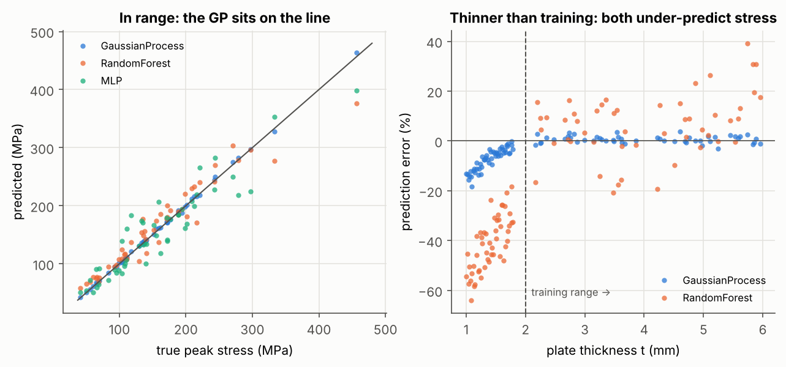

# Plate with a hole: surrogate model sandbox

A small, self-contained surrogate modelling exercise: predict the peak stress at a
circular hole in a flat plate under tension, and test what happens when the models
are asked about designs outside their training data.

**The labels are synthetic.** Instead of running FEA, each "simulation" is the
closed-form answer (Heywood's stress concentration factor) plus 1 % random noise
standing in for mesh error. Because the true answer is known everywhere, the
models can be checked exactly, including far outside the training range.
For a version trained on a real FEA solver, see
[composite-panel-surrogate](https://github.com/fabio-pontrandolfo/composite-panel-surrogate).

## Problem

Inputs: plate width W (40–100 mm), hole diameter d (5–30 mm), thickness t (2–6 mm),
load F (5–20 kN). Output: peak stress at the hole edge (MPa).

```
σ_peak = Kt · F / ((W − d) · t),   Kt = 2 + (1 − d/W)³   (Heywood)
```

## Method

1. **Design of experiments**: 200 points from a Latin hypercube over the four inputs;
   150 for training, 50 held out.
2. **Models**: Gaussian process (RBF kernel + noise term), random forest, MLP. All
   fitted on log(stress), because stress spans a wide range and the formula is a product.
3. **Extrapolation test**: 50 new designs with plates *thinner* than anything in
   training (1–1.8 mm vs 2–6 mm).

## Results

| Model | R² (holdout) | Mean abs. error | Max error |
|---|---|---|---|
| Gaussian process | 0.999 | 1.9 MPa | 3.8 % |
| Random forest | 0.923 | 16.1 MPa | 39.2 % |
| MLP | 0.870 | 21.4 MPa | 55.7 % |

| Extrapolation (thinner plates) | Mean error | GP 95 % interval holds the true value |
|---|---|---|
| Gaussian process | 7.4 % (vs 1.2 % in range) | 30 % of designs (vs 92 % in range) |
| Random forest | 41.2 % | — |



What it shows:

- **With 150 points, the GP is at the noise floor** (1.2 % mean error with 1 % noise).
  The random forest and the MLP need far more data for a smooth function like this.
- **Out of range, both models under-predict the stress**, which is the unsafe direction.
  The random forest cannot extrapolate at all: it predicts roughly the stress of the
  thinnest training plates.
- **The GP's uncertainty grows, but not nearly enough.** Its predicted std only doubles
  while the error grows six-fold, so its 95 % interval misses most extrapolated designs.

## Next steps

- [ ] **Physics-based features.** Since stress = Kt · F / ((W − d) · t), fit a linear model
      on log F, log t, log(W − d) and d/W. Compare it with the GP, especially out of range.
- [ ] Replace the formula with a real FEA solver (done in composite-panel-surrogate)
- [ ] Learning curve: how many training points does each model need?

## Run it

```bash
pip install -r requirements.txt
python plate_surrogate.py     # ~20 s; prints the tables, writes results/
```

---

*Built with AI assistance (Claude); the problem definition and validation approach are mine. I'm reviewing and extending the code.*
